# BIAS-0 Assurance

**Fairness evidence your regulator can check.**

Upload a log of decisions. Get a verdict with an error bar, the release it lines up with, and a report your
regulator can check.

BIAS-0 audits the decisions your lending, hiring or insurance system actually made, without access to the
model and without writing code. Every number carries an honest error bar. The output is an audit-ready report
mapped to the EU AI Act, NYC Local Law 144, RBI FREE-AI and India's DPDP Act, ending in a plain-language list
of what to do next.

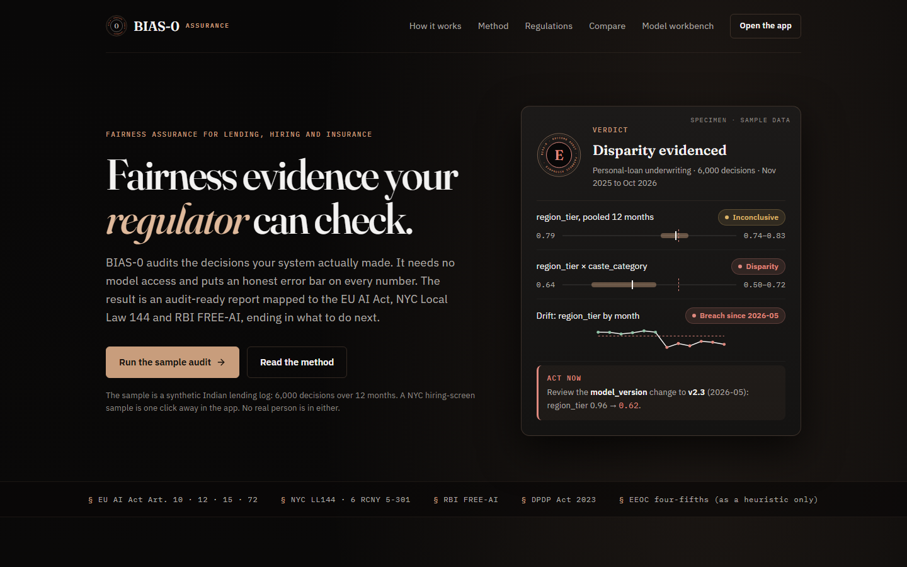

**Try it in 30 seconds:** run the app in demo mode (below), open **Outcome Audit** and click **Run this audit** on
the lending or the hiring sample.

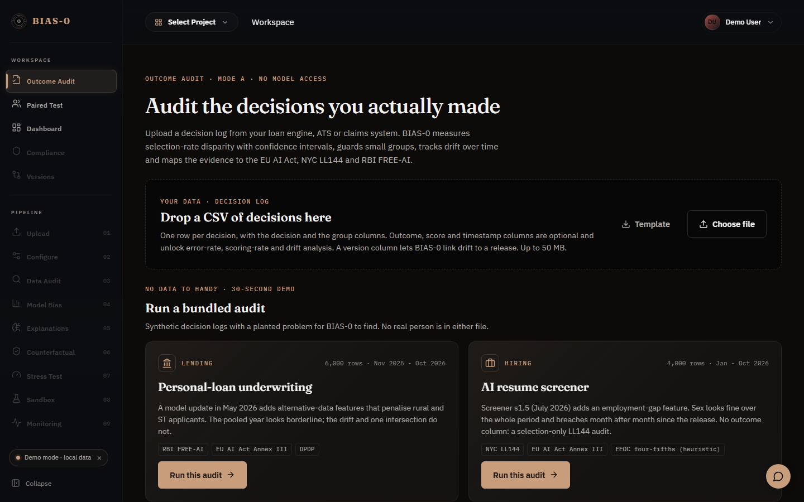

### What's new in this build

- **Change attribution.** When fairness drifts, BIAS-0 checks whether a version or policy column switched at
  the same time and puts the before/after impact ratio on the chart: *screener_version s1.4 → s1.5 in 2026-07:
  impact ratio 0.96 → 0.56*. It is worded as a lead to investigate, never as proof of cause.
- **What to do next.** Every audit ends with an ordered, owner-tagged action plan a non-specialist can act on:
  *Act now*, *Next*, *For the record*. It is the first section of the report too.
- **A hiring sample next to the lending one.** A 4,000-row NYC resume-screen log with scores, EEO race
  categories, an undisclosed category, a group too small to rank and no outcome column: an LL144 audit
  end to end.
- **Reproduce a report.** Every report carries a fingerprint of its exact settings. An auditor, regulator or
  customer drops the report and the CSV into **Reproduce a report**: BIAS-0 checks the file's SHA-256 and re-runs
  the audit, then compares the verdict, grade and every impact-ratio interval. An edited report or a doctored
  log shows up line by line.
- **Paired test (Mode B).** For vendor APIs and LLM screeners you cannot inspect. BIAS-0 builds the probe set
  (synthetic resumes sent twice, identical except for a first name from each of two lists you can edit; seeded,
  so the same settings always give the same file), the CLI sends it to the screener's HTTP endpoint (with a
  dry-run and an offline mock screener), and the results come back for an exact McNemar test with CIs on the rate
  and score differences. The bundled sample is a name-swap test of an LLM resume screener: 37 flips, 35 of them
  favouring the male-coded version (p < 0.0001).
- **NYC LL144 public summary.** One click drafts the page an NYC employer must post for an automated
  employment decision tool (6 RCNY 5-303): audit date, data source and explanation, applicants assessed, unknown
  category count, selection *and* scoring rates with impact ratios per category and for the sex × race/ethnicity
  intersection. Auditor name and distribution date stay as visible blanks until filled in.
- **Starter template.** The drop zone offers a CSV template with the columns BIAS-0 recognises, including the
  version column that change attribution uses.
- **Where it fits.** The landing page and [`docs/PRODUCT.md`](docs/PRODUCT.md) compare BIAS-0 with Fairlearn,
  AIF360 and the What-If Tool, and position it as complementary: BIAS-0 for the audit, a toolkit for the fix.

| | |
|---|---|
| **What to do next (hiring sample)**<br>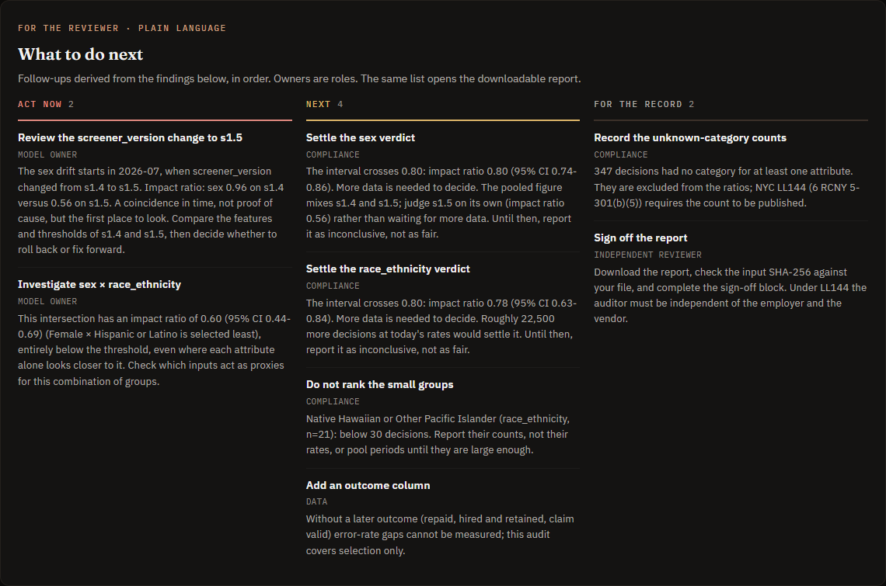 | **Drift linked to the screener release**<br>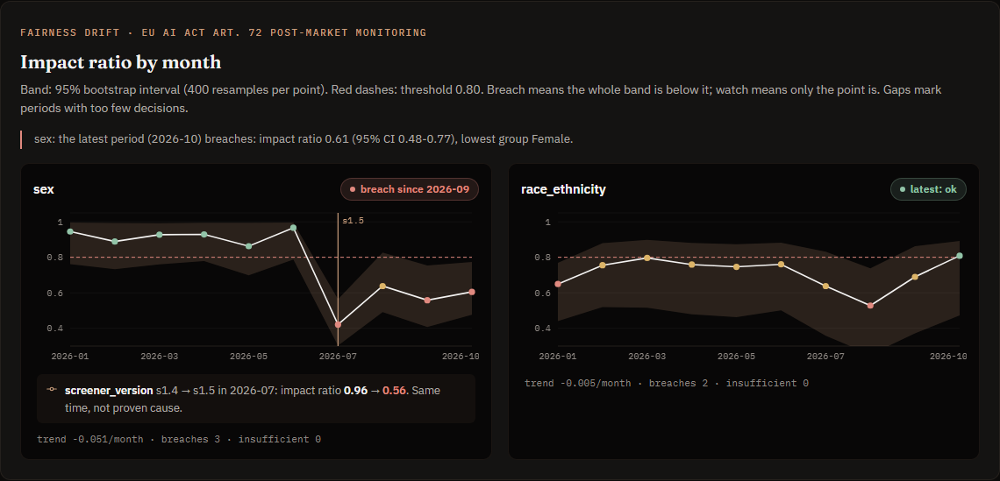 |
| **Reproduce a report from its CSV**<br>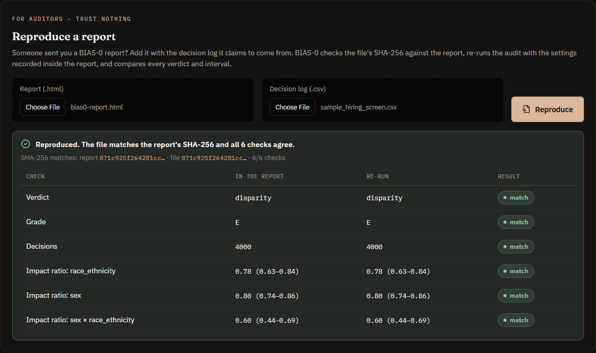 | **The report opens with the action plan**<br>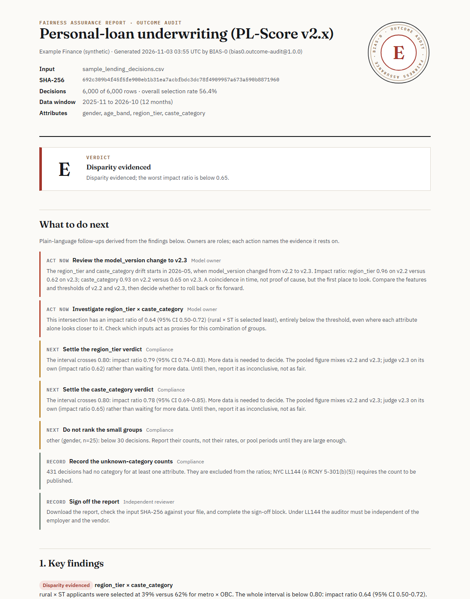 |
| **NYC LL144 public summary (hiring sample)**<br>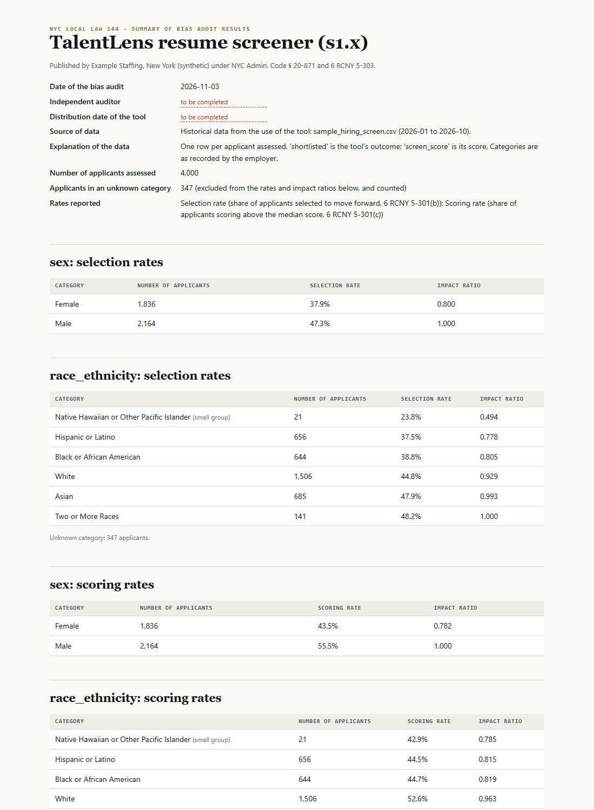 | **Paired test of an LLM screener (Mode B)**<br>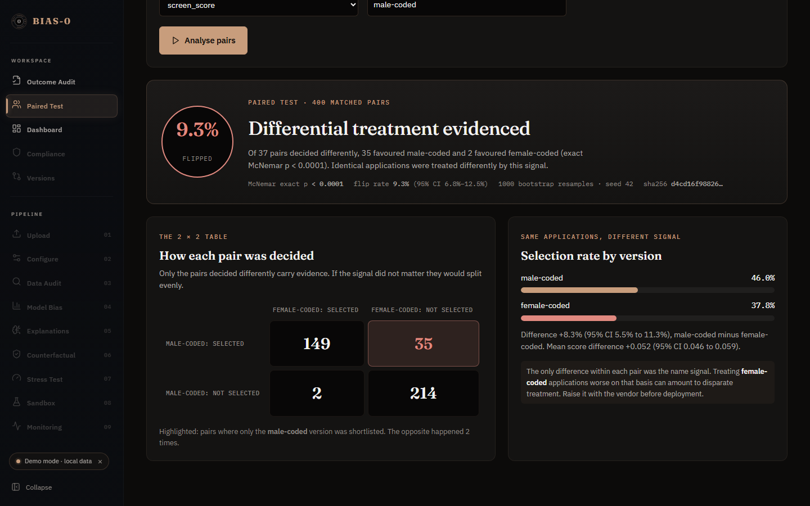 |
| **Paired test, step 1: build the name-swapped probe set**<br>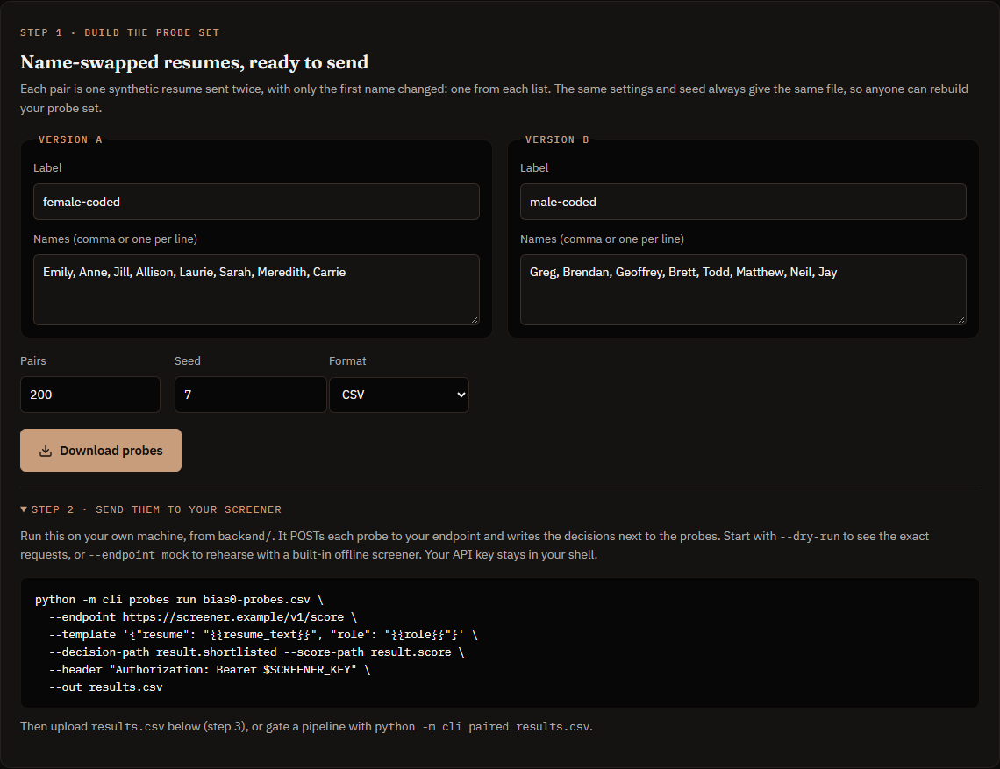 | |

### Everything it does

- **Outcome audit (Mode A).** Upload a decision log. You get selection rates with Wilson intervals, LL144
  impact ratios, bootstrap CIs on every gap, error-rate gaps when outcomes are known, and intersectional
  cells, all with small-sample guards.
- **A verdict decided from the interval, not the point.** The three outcomes are *Disparity evidenced*,
  *No material disparity* and *Inconclusive*. The A–E grade follows a published rule and is capped at C when
  the data cannot decide.
- **Fairness drift.** Impact ratio per week, month or quarter, with a 95% band and breach and watch alerts,
  and the version switch that coincides with a breach drawn on the chart.
- **Action plan.** Plain-language next steps with owners, including a rough count of the extra decisions an
  inconclusive verdict needs.
- **Mitigation trade-off.** When the log has a score and an outcome, BIAS-0 sweeps group-specific
  thresholds from one shared threshold to equal selection rates. Accuracy and impact ratio are measured on a
  holdout half, by default over the period since the drift breach. That answers "what would closing the gap
  cost?" without the model.
- **Framework-mapped report.** A self-contained HTML report you can print to PDF. It carries the input
  SHA-256, the method, findings, regulatory controls (evidenced, partial or not evidenced), limitations and a
  sign-off block.
- **Reproducible reports.** A settings fingerprint in each report, and `POST /assurance/verify-report` to
  re-run and compare it against the CSV.
- **Hash-chained audit ledger.** Every audit is appended to a per-user SHA-256 chain. Editing or deleting
  history is detected.
- **Model workbench (Mode C).** If you own the model, BIAS-0 can train or load it and add SHAP, proxy
  detection, counterfactual flips, stress tests, a mitigation sandbox, calibration by group and verifiable
  evidence bundles.

Product positioning, ICP, pricing sketch and roadmap: [`docs/PRODUCT.md`](docs/PRODUCT.md).
A 5-minute demo script: [`docs/DEMO.md`](docs/DEMO.md).

---

## See it

| | |
|---|---|
| **Verdict and findings**<br>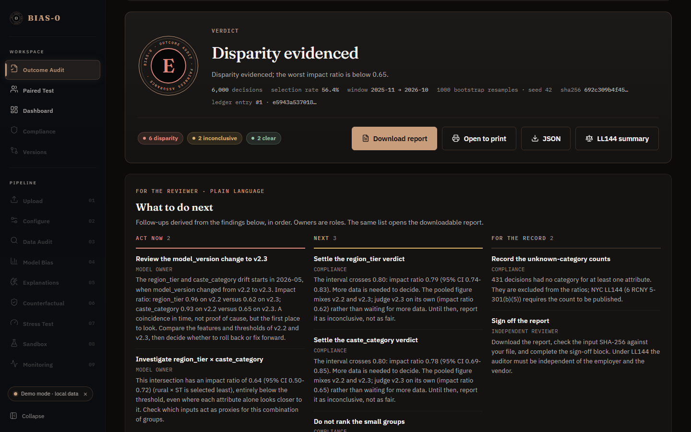 | **Fairness drift by month**<br>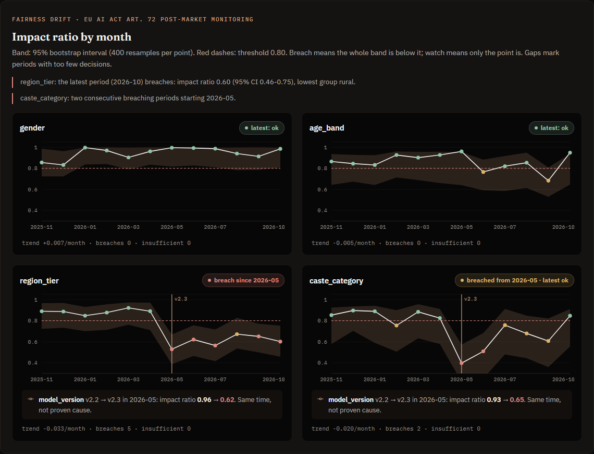 |
| **LL144 impact ratios with intervals**<br>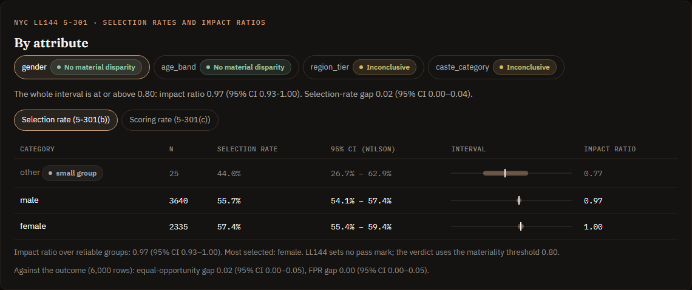 | **Intersections with suppressed cells**<br>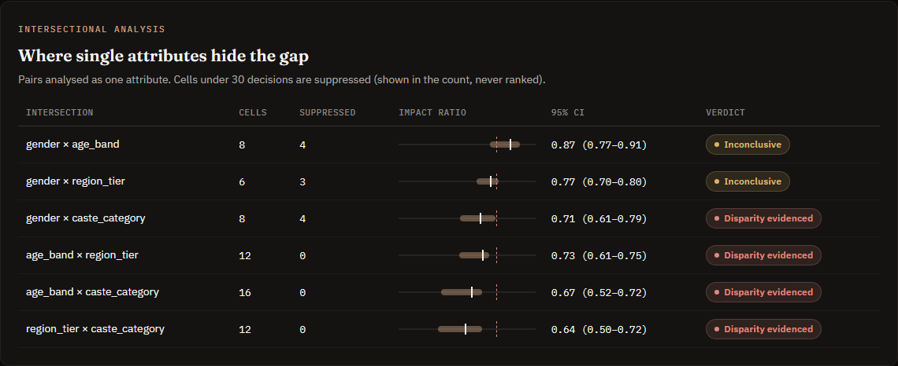 |
| **Regulatory mapping**<br>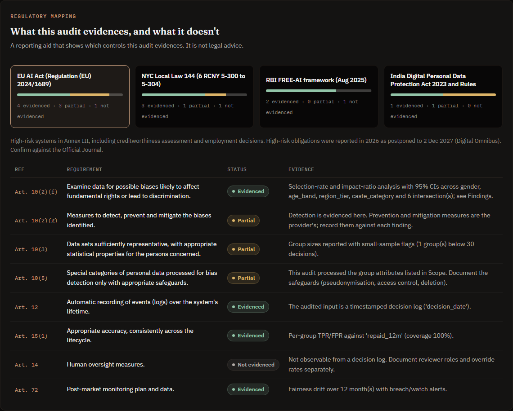 | **The assurance report (print to PDF)**<br> |
| **Mitigation trade-off (holdout)**<br>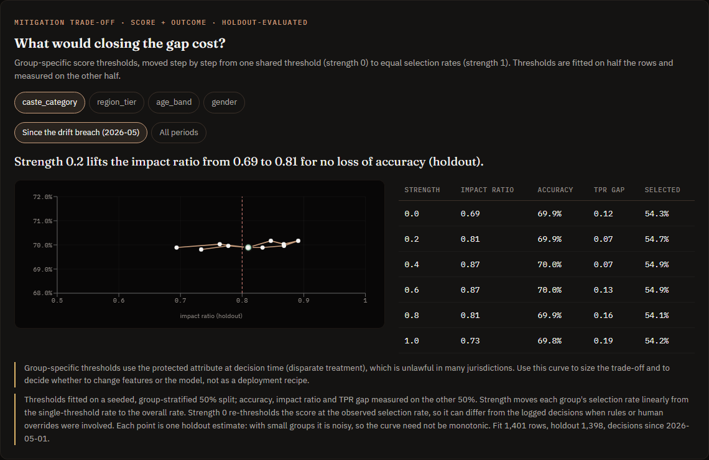 | **Hash-chained audit history**<br>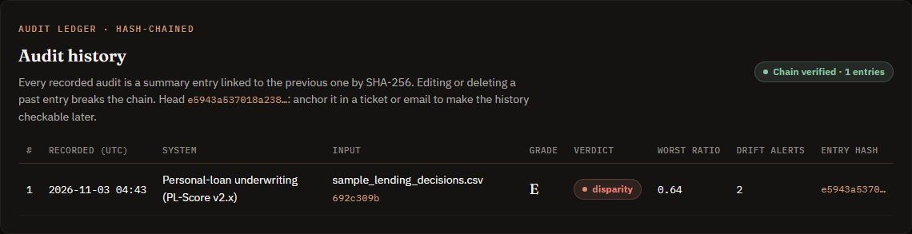 |
| **What to do next (lending sample)**<br>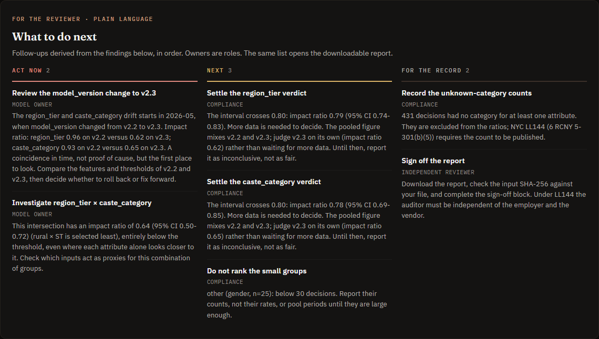 | **Where it fits: BIAS-0 next to the toolkits**<br>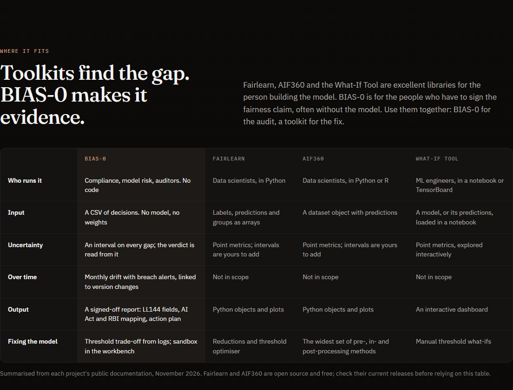 |
| **Mobile (390 px)**<br>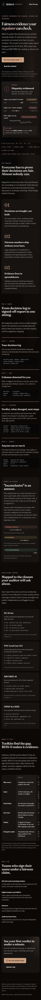 | **Paired test on a phone**<br>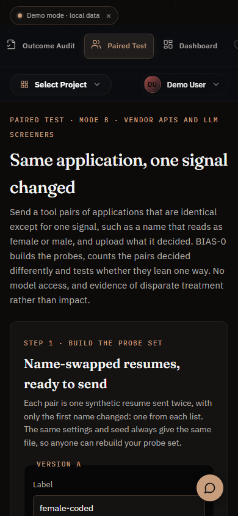 |

All screenshots are taken headlessly from the bundled synthetic sample
(`cd frontend && BASE=http://localhost:8000 node scripts/screenshots.mjs`).

---

## Quickstart (local demo mode, about 2 minutes)

```bash
# API
cd backend
python -m venv .venv && source .venv/bin/activate     # Windows: .venv\Scripts\activate
pip install -r requirements.txt
DEMO_MODE=1 uvicorn main:app --port 8000               # PowerShell: $env:DEMO_MODE=1; uvicorn main:app --port 8000

# UI (second terminal)
cd frontend
npm install
npm run dev                                            # http://localhost:5173 (proxies /api to :8000)
```

Open the app and click **Run the sample audit** (or open **Outcome Audit** and pick the lending or hiring card). Demo mode turns off Firebase and auth, keeps data in memory and
stores uploads locally. Never deploy with `DEMO_MODE=1`. For a single process, run `npm run build` and the API
serves the UI at `:8000`.

Audit from the command line, without the UI:

```bash
curl -s -X POST localhost:8000/api/assurance/outcome-audit/report \
  -F file=@backend/samples/sample_lending_decisions.csv \
  -F decision_col=decision -F group_cols=gender,age_band,region_tier,caste_category \
  -F outcome_col=repaid_12m -F score_col=model_score -F time_col=decision_date \
  -F system_name="Personal-loan underwriting" -o report.html
```

As a fairness gate in a pipeline (no server; exits 1 when the verdict reaches `--fail-on`):

```bash
cd backend
python -m cli audit samples/sample_hiring_screen.csv --report report.html --json audit.json --fail-on disparity
# BIAS-0 outcome audit: Disparity evidenced (grade E)
# Act now:
#   - Review the screener_version change to s1.5 (Model owner)
# Gate (--fail-on disparity): FAILED
python -m cli verify report.html samples/sample_hiring_screen.csv   # exit 0 only if the report reproduces
```

Column roles you do not pass are detected as in the UI (`--time ''` skips a detected one).

A paired test of a vendor or LLM screener, end to end (the probe set can also be downloaded from the Paired Test
page or `POST /api/assurance/paired/probes`):

```bash
cd backend
python -m cli probes generate --pairs 300 --seed 7 --out probes.csv \
  --group "female-coded=Emily,Anne,Sarah" --group "male-coded=Greg,Todd,Neil"   # or .jsonl
python -m cli probes run probes.csv --endpoint https://screener.example/v1/score --dry-run --limit 2
python -m cli probes run probes.csv --endpoint https://screener.example/v1/score \
  --template '{"resume": "{{resume_text}}", "role": "{{role}}"}' \
  --decision-path result.shortlisted --score-path result.score \
  --header "Authorization: Bearer $SCREENER_KEY" --delay 0.2 --out results.csv
python -m cli paired results.csv --fail-on disparity
# (output with --endpoint mock --mock-penalise female-coded in place of the real screener)
# BIAS-0 paired test: Differential treatment evidenced
#   300 pairs, flip rate 23.3%, exact McNemar p < 0.0001
#   Of 70 pairs decided differently, 61 favoured male-coded and 9 favoured female-coded ...
# Gate (--fail-on disparity): FAILED
```

`--endpoint mock` answers with a built-in, seeded stand-in screener (`--mock-penalise female-coded` docks one
version) so the whole loop can be rehearsed offline. The requests go from your machine, not from the BIAS-0
server: the server never calls a URL a user typed, and the screener's key stays in your shell. A probe whose
call fails is recorded in an `error` column, and its pair is dropped and counted in the analysis.
In GitHub Actions, after the step that exports last month's decisions:

```yaml
- run: pip install -r backend/requirements.txt
- run: python -m cli audit ../exports/decisions.csv --report ../fairness-report.html --fail-on disparity
  working-directory: backend
- uses: actions/upload-artifact@v4
  if: always()
  with: { name: fairness-report, path: fairness-report.html }
```

The hiring sample over HTTP, selection and scoring rates, no outcome column:

```bash
curl -s -X POST localhost:8000/api/assurance/outcome-audit \
  -F file=@backend/samples/sample_hiring_screen.csv \
  -F decision_col=shortlisted -F group_cols=sex,race_ethnicity \
  -F score_col=screen_score -F time_col=applied_date | python -m json.tool | less
```

`GET /api/assurance/samples` lists both bundled logs with the column mapping each needs.

| Variable | Where | Effect |
|---|---|---|
| `DEMO_MODE=1` | backend | No Firebase, auth off, in-memory data, local uploads |
| `BIAS_BOOTSTRAP_N` / `BIAS_BOOTSTRAP_SEED` | backend | Bootstrap resamples (default 1000) and seed (default 42) |
| `BIAS_MIN_GROUP_SIZE` | backend | Groups below this many decisions are flagged and left out of gaps and verdicts (default 30) |
| `LOCAL_STORAGE_DIR` | backend | Upload directory when Firebase Storage is unavailable |
| `CORS_ORIGINS` | backend | Extra allowed origins, comma-separated, if the UI is served from another domain |
| `VITE_DEMO_MODE` | frontend | `1` forces demo UI, `0` forces Firebase |

Full Firebase setup: copy `backend/.env.example` and `frontend/.env.example` to `.env`, fill in the
placeholders and run without `DEMO_MODE`.

---

## Deploy

One image serves the API and the built UI on one port, and honours `$PORT` (Cloud Run, Render, Fly, Railway).

```bash
docker build -t bias0 .
docker run -p 8080:8080 -e DEMO_MODE=1 bias0                 # public sample-data demo: auth off, in-memory
docker run -p 8080:8080 --env-file backend/.env bias0        # real use: Firebase auth, Firestore, Storage
# or: docker compose up --build   (reads backend/.env if present)
```

- `backend/.env.example` lists every variable; copy it to `backend/.env` and fill in the Firebase service
  account. `.dockerignore` keeps `.env` files out of the image, so secrets come from the platform's secret store.
- The container runs as an unprivileged user, has a `/health` healthcheck, and writes demo uploads to
  `LOCAL_STORAGE_DIR`. With Firebase configured, uploads go to Firebase Storage and data to Firestore.
- `DEMO_MODE=1` is only for a public demo on the bundled synthetic logs. Anyone can use it and nothing is kept.
- The image installs the CPU-only XGBoost wheel (`xgboost-cpu`). The default Linux `xgboost` wheel is built with
  CUDA (57.6 MB) and pulls `nvidia-nccl-cu13` (305 MB); `xgboost-cpu` is 5.8 MB, so the image is about 357 MB
  smaller, and nothing probes for a GPU. macOS keeps `xgboost`, which is CPU-only there.
- The frontend reads its Firebase web config from `frontend/.env` at build time (`frontend/.env.example`). With
  no config it builds in demo mode.

---

## The sample datasets

`backend/samples/sample_lending_decisions.csv` holds 6,000 synthetic personal-loan decisions from Nov 2025 to
Oct 2026. It is generated by `python -m utils.decision_log_sample` (seeded; a test checks that the file matches
the generator). It encodes a story for the audit to find:

- Creditworthiness is drawn from the same distribution for every group.
- In May 2026, model `v2.3` adds alternative-data features that penalise **rural** and **ST** applicants.
- `gender = other` has 25 rows, too few to rank. It is flagged, not ranked.
- 7% of applicants did not disclose a caste category. They are excluded from the rates and counted, as LL144 requires.

What the audit finds: over the pooled 12 months, region and caste are only *inconclusive* (impact ratio 0.79,
CI 0.74–0.83). The drift view shows region breaching in 5 of the 6 months from 2026-05, and the intersection
rural × ST is clearly below 0.8 (0.64, CI 0.50–0.72). That is why BIAS-0 looks at time and intersections and
not just a pooled number. The action plan's first item names the cause to check: *model_version v2.2 → v2.3*,
region_tier 0.96 → 0.62 and caste_category 0.93 → 0.65.

`backend/samples/sample_hiring_screen.csv` holds 4,000 synthetic applications screened by an AI resume screener
for a New York employer, Jan to Oct 2026 (`python -m utils.hiring_log_sample`; a test checks it matches):

- Every candidate has a `screen_score` and a `shortlisted` decision, so LL144 selection *and* scoring rates apply.
- Screener `s1.5` (July 2026) adds an employment-gap feature. Career breaks are far more common among women in
  this log, so the female shortlist rate falls.
- A school-tier feature costs Black and Hispanic or Latino candidates a little throughout.
- Native Hawaiian or Other Pacific Islander candidates number 21: flagged, not ranked. 9% did not disclose
  race/ethnicity: excluded and counted.
- No outcome column: the audit says error-rate fairness was not assessed and asks for one.

What the audit finds: pooled, sex reads *inconclusive* (impact ratio 0.80, CI 0.74–0.86). Month by month it
breaches from July, and the chart marks the s1.5 release: 0.96 on s1.4, 0.56 on s1.5. The worst intersection is
female × Hispanic or Latino (0.60, CI 0.44–0.69).

---

## Architecture

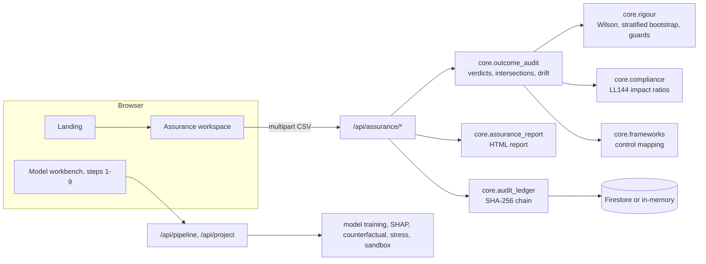

| Path | What it is |
|---|---|
| `backend/core/action_plan.py` | Version-switch detection, drift-to-change links (before/after impact ratio), the owner-tagged action plan |
| `backend/utils/samples.py` | The bundled sample catalogue (lending, hiring) with their column mappings |
| `backend/core/outcome_audit.py` | Mode A engine: decision binarisation, per-attribute and intersectional analysis, verdict rule, A–E grade, drift, findings |
| `backend/core/rigour.py` | Wilson intervals, stratified percentile bootstrap, small-group flags (cross-checked against fairlearn) |
| `backend/core/compliance.py` | NYC LL144 impact ratios per 6 RCNY 5-301, scoring rates, 5-301(d) exclusion |
| `backend/core/frameworks.py` | EU AI Act / LL144 / RBI FREE-AI / DPDP control mapping |
| `backend/core/assurance_report.py` | Self-contained HTML report: no scripts, every user string escaped |
| `backend/core/tradeoff.py` | Group-threshold sweep: seeded stratified 50/50 split, holdout accuracy / impact ratio / TPR gap |
| `backend/core/audit_ledger.py` | Hash-chained audit history (RFC 8785 canonical JSON) |
| `backend/routers/assurance.py` | `POST /inspect`, `POST /outcome-audit`, `POST /outcome-audit/report`, `POST /tradeoff`, `POST /paired`, `GET /paired/sample`, `POST /paired/probes`, `POST /ll144-summary`, `POST /verify-report`, `GET /history`, `GET /samples`, `GET /sample?name=`, `GET /frameworks` |
| `backend/core/paired.py` | Paired-probe analysis: 2x2 table, flip rate, exact McNemar, bootstrap CIs, verdict |
| `backend/core/probes.py`, `core/probe_runner.py` | Name-swapped probe sets (seeded, fingerprinted, CSV/JSONL) and the HTTP runner behind `cli probes run` (mock, dry-run) |
| `backend/core/ll144_summary.py` | The NYC LL144 public summary page (5-303 facts, rates and impact ratios, intersections) |
| `backend/cli.py` | Command-line audit and verify: a fairness gate for CI (`python -m cli audit`, `python -m cli verify`) |
| `backend/core/report_verify.py` | Report fingerprint (settings + expected numbers) and reproduction from the CSV |
| `frontend/src/pages/Landing.tsx`, `Assurance.tsx` | Landing page and audit workspace |
| `frontend/src/styles/brand.css` | The brand layer: hallmark, verdict colours, Fraunces / IBM Plex |

---

## Methodology

**Inputs.** One row per decision. The decision column is binarised: the favourable value is chosen by the user
or inferred from wording (approved, hired, yes). A column with three or more text values and no chosen
favourable value is rejected rather than guessed. Missing group values form an `(missing)` category.

**Selection rates and impact ratios.** Per category, selection rate = selected / decisions, with a 95% Wilson
interval. Impact ratio = category rate / highest category rate, which is the 6 RCNY 5-300 definition. Unknown
categories are excluded and counted (5-301(b)(5)). With a score column, scoring rates (share above the
full-sample median, 5-301(c)) are reported too.

**Gaps and uncertainty.** The selection-rate gap (max − min) and the impact ratio (min / max) are computed over
*reliable* groups (n ≥ 30 by default), each with a stratified percentile bootstrap CI: 1,000 resamples, every
group resampled at its own size, seeded. With an outcome column, equal-opportunity (TPR), FPR and FNR gaps are
computed the same way on rows with a known outcome.

**Verdict.** For each attribute and intersection, using the CI of the impact ratio and a materiality threshold
*t* (default 0.80):

| Verdict | Rule |
|---|---|
| Disparity evidenced | CI upper bound < *t* |
| No material disparity | CI lower bound ≥ *t* |
| Inconclusive | the CI contains *t*, or fewer than two reliable groups |

Intersections can only escalate the overall verdict. An inconclusive cell never downgrades it.

**Grade.** A: all clear, and every CI lower bound ≥ 0.90. B: all clear. C: anything inconclusive and nothing
evidenced (capped). D: disparity evidenced, worst ratio ≥ 0.65. E: below 0.65. The rule is printed on every
report.

**Drift.** The decision log is bucketed by period (automatic: week for spans up to 120 days, month up to 3
years, quarter beyond). For each period there is an impact ratio with a 400-resample band. Statuses: *breach*
(the band is entirely below *t*), *watch* (the point is below, the band crosses *t*), *ok*, or *insufficient*
(fewer than two reliable groups). An alert fires when the latest period breaches or two consecutive periods
do. The trend is a size-weighted least-squares slope.

**Paired test.** Each pair id must have exactly one row per variant (two variants overall); other pairs are
dropped and counted. The discordant pairs (one version selected, the other not) are tested with an exact two-sided
binomial (McNemar) test against an even split. The selection-rate difference and the mean paired score difference
get percentile-bootstrap CIs over pairs (seeded). Verdict: *differential treatment evidenced* when p < 0.05;
*no material difference* when the rate-difference CI lies within ±5 points; otherwise *inconclusive* (also below
30 pairs). The test isolates the signal you varied, so it speaks to disparate treatment, not disparate impact.
Generated probe sets share everything within a pair (role, years, skills, employers, degree, surname) except the
first name; the order of the two versions is randomised per pair, and each probe carries a `probe_set`
fingerprint (a short SHA-256 of the groups, names, pair count, roles and seed). The default name lists follow the
correspondence-study tradition (Bertrand and Mullainathan, 2004) and are examples, not a validated instrument:
use names validated for the population and signal you test.

**Change attribution.** A column is a *switch* when its dominant value (at least 80% of a period's rows) changes
between consecutive periods, at most three times (more is noise, not a release). Decision, outcome, score and group
columns are excluded, and names like version, model, release, policy or screener are ranked first. For each
attribute, the drift *onset* is the start of the latest run of watch/breach periods that contains a breach. A
switch within one period of the onset is linked, with the point impact ratio over rows on the old value and on the
new one. The link is a coincidence in time; the text says so.

**Action plan.** Rules over the result, in a fixed order: linked switches (one action per switch, listing every
attribute it moved), unlinked breaches, the worst evidenced intersection, evidenced attributes, inconclusive
attributes (with either the pooled-mix explanation when a switch is linked, or a rough extra-decisions estimate:
the interval half-width shrinks like 1/√n, so n grows by (current / needed half-width)²), small groups, a missing
outcome column, unknown-category counts, and sign-off. Deterministic: the same file gives the same plan.

**Mitigation trade-off.** For one attribute, the rows are split 50/50 (seeded, stratified by group).
Thresholds are fitted on one half and everything is measured on the other. At strength *s*, each group's
target selection rate is (1 − *s*) × its single-threshold rate + *s* × the overall rate, and its threshold is
the matching quantile of its scores. *s* = 0 is one shared threshold and *s* = 1 is equal selection rates. The
panel reports the smallest strength that reaches the threshold on the holdout, and its accuracy cost.
Group-specific thresholds are disparate treatment and unlawful in many settings. The curve sizes the
trade-off; it is not a deployment recipe, and the API says so in every response.

**Reproducibility.** The input SHA-256, the metric and schema versions, library versions and the bootstrap seed
are recorded. The same file and settings give the same report. Each report also embeds a fingerprint in a
`<meta name="bias0-audit">` tag (data, not a script): the mapping, favourable values, period, threshold, bootstrap
count and seed, minimum group size, and the verdict, grade, decision count and every impact-ratio interval.
`POST /assurance/verify-report` (report + CSV) checks the SHA-256, re-runs the audit with those settings and
compares each number to 4 decimal places. The verdict says which of four cases applies: reproduced; same numbers
but a different file; same file but different numbers (an edited report or another BIAS-0 version); or neither.

### Honest limitations

- An outcome audit measures **disparity, not its cause**. It does not test whether a gap is justified by
  legitimate factors (for example income or bureau score), and it is not a legal finding.
- The 0.80 threshold is the EEOC four-fifths **heuristic**. LL144 sets no pass mark. A ratio above 0.80 is not a
  certificate of fairness.
- Groups that were not recorded cannot be assessed. Proxies (pincode, surname, institution) need the workbench's
  proxy analysis or a paired test (Mode B), which varies a signal such as a name rather than reading a column.
- Error-rate metrics inherit the quality of the outcome label. If outcomes exist only for approved applicants
  (selective labels), they are biased. BIAS-0 warns when outcome coverage is below 100%.
- Bootstrap intervals assume independent decisions. Repeat applicants or batch effects make them too narrow.
- Intersections cover pairs among the first four group columns, not triples.
- The ledger is unsigned. Anyone able to rewrite the whole store can recompute every hash, so anchor the head
  hash outside the system. The regulatory statuses in the report are a reporting aid, not legal advice.

---

## Tests

```bash
cd backend && pip install -r requirements-dev.txt
python -m pytest -q                              # 306 tests, about a minute
cd frontend
npm run check                                    # eslint + tsc
npm run test:unit                                # node:test unit tests
# browser specs against a demo API (no model training for the assurance spec)
cd backend && DEMO_MODE=1 uvicorn main:app --port 18521
cd frontend && API_PORT=18521 VITE_PORT=18522 npx playwright test tests/assurance.spec.ts tests/hiring-sample.spec.ts tests/paired-test.spec.ts tests/project-settings.spec.ts
# PW_EXE=/path/to/chrome-headless-shell uses a specific browser binary if the Playwright cache does not match
```

The outcome-audit tests check hand-computed rates and impact ratios, each verdict branch, every grade rule,
small-group and unknown-category handling, intersection escalation, drift statuses on a constructed breach,
the sample story, framework statuses, HTML escaping of hostile column names, and ledger tamper detection
(an edit, an edit with a recomputed hash, a deletion).

## Model workbench (Mode C)

The original nine-step workflow is still there for teams that own their model: upload → configure → data
audit (representation, proxies) → model bias (fairlearn-checked metrics with CIs and calibration by group) →
SHAP explanations → counterfactual flips → stress test → mitigation sandbox → monitoring. Evidence bundles
from the workbench can be verified with `python -m core.evidence_integrity <bundle.zip>`; see
[`docs/evidence-pack.md`](docs/evidence-pack.md).

Each workbench project keeps its audit settings. Open **Project settings** (the gear next to a project in the
project selector) to choose the NYC LL144 rate type: *selection rate* for a tool that decides, or *scoring
rate* for a tool that outputs a score (6 RCNY 5-301(b)/(c)). Every later run records the choice in its
provenance, the report and the evidence pack.

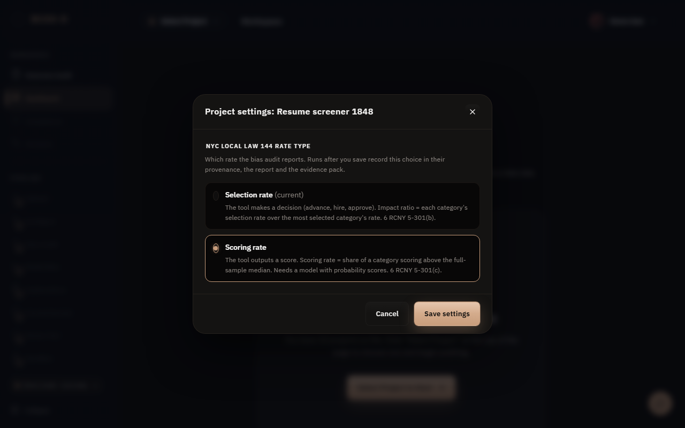

| | |
|---|---|
| 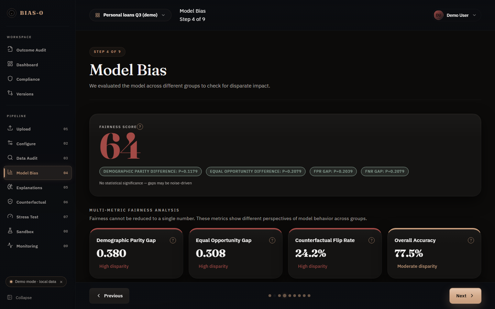 | 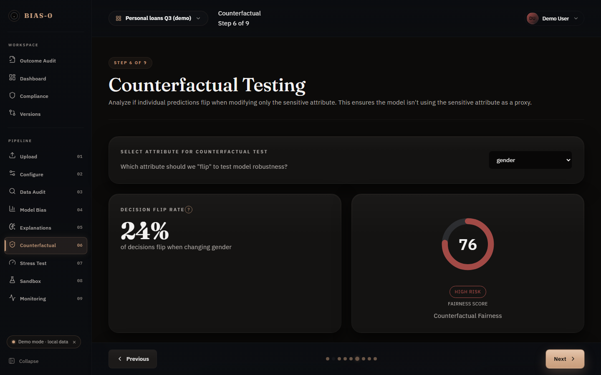 |

BIAS-0 never certifies a system as "unbiased". Every report says what was tested, on which data, when, and with
what uncertainty.
